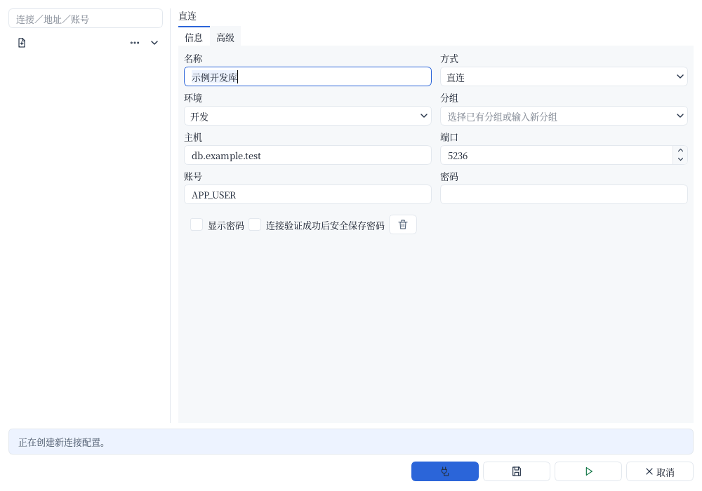
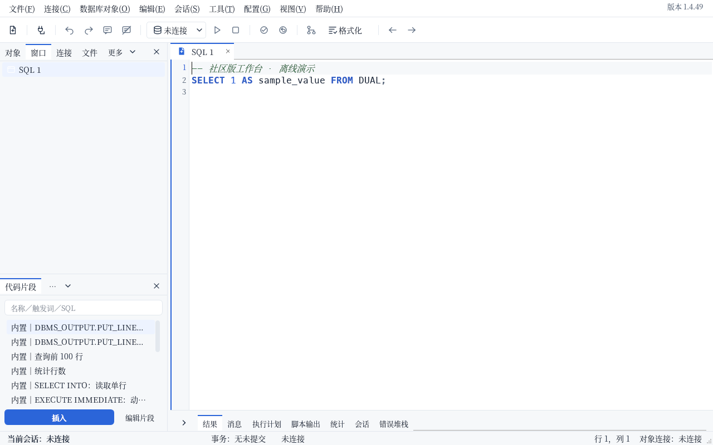
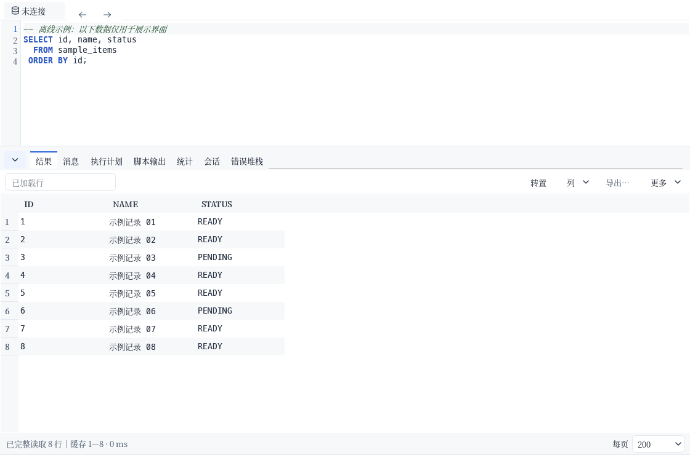
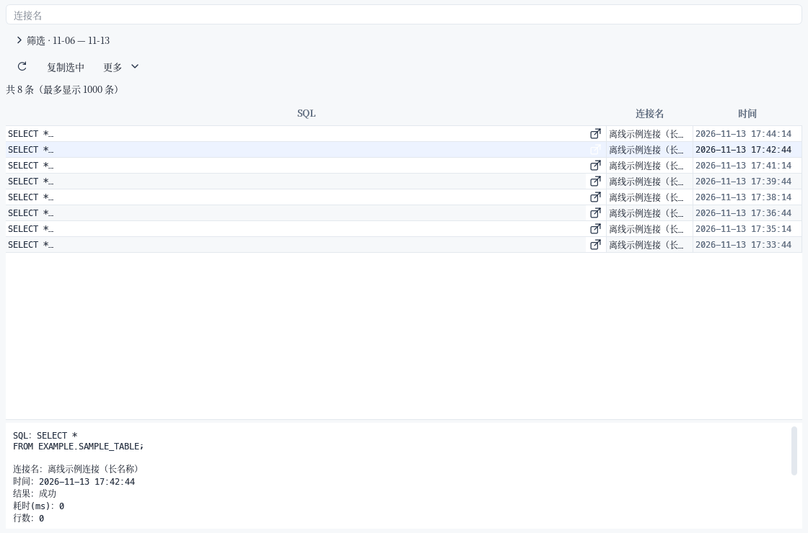

# GzydDmTools Community 操作手册

本手册适用于 1.4.49 社区版达梦数据库工作台和 CLI。文中的连接、SQL 结果与日志均使用示例数据。

## 目录

1. 运行准备与第一次连接
2. 连接管理、主备与事务
3. 工作台、窗口和文件
4. SQL 编辑与执行
5. 编辑器历史、文本转换和代码片段
6. 查询结果、数据编辑和导入导出
7. 对象浏览、程序源码和编译
8. Command 脚本发布
9. Test Window 与调试
10. DBA、参数及许可证信息
11. 操作日志、恢复和清理
12. 设置与快捷键
13. CLI 使用
14. 常见问题与反馈

# 1. 运行准备与第一次连接


启动页显示应用名称、版本和准备状态。

### 运行前准备

- 业务客户端面向 Windows x64。源码目录不等于可直接安装的程序；自行构建的步骤见仓库 README。
- 运行目录需要匹配的 Qt、达梦 DPI 及其依赖。语言服务为独立程序；调试还需要匹配的调试运行依赖。缺少其中一项时，应按对应功能的错误信息处理。
- 社区源码不附带达梦 SDK、DLL 或调试器 EXE。请通过有权使用的渠道取得这些依赖；不要把个人运行目录或数据库凭据提交到源码仓库。
- macOS 使用完整 Windows 运行目录加 Wine 的路线，不是原生客户端。社区源码不提供已验证的 Mac 安装包或内置 Wine 环境。

### 创建第一条连接

1. 启动工作台，打开“连接 → 连接管理…”。
2. 新建连接，填写名称、环境、账号及连接方式。首次使用建议选择直连，并使用只具备所需权限的测试账号。
3. 直连填写数据库主机和端口，例如 `db.example.test:5236`。此地址仅为示例，替换为自己的环境。
4. 填写密码，点击“测试”，查看本次测试的实际节点与错误详情。单纯点击“保存”只保存参数，不代表连接已通过测试。
5. 保存连接。密码按勾选项使用本机安全凭据库保存；连接配置导出不包含密码。
6. 新建 SQL Window，选择连接。对象浏览使用应用主连接，已有 SQL／Command 窗口有自己的连接，切换应用主连接不会自动替换它们。
7. 核对窗口连接和环境，执行不修改数据的检查：

```sql
SELECT 1 FROM DUAL;
```

成功后应看到结果表格及消息。没有结果时，先看消息或错误堆栈，不要直接重复执行写语句。

# 2. 连接管理、主备与事务



图中主机和账号为虚构值，密码为空；保存连接不会自动执行测试。

### 选择连接方式

| 方式 | 填写内容 | 适用情形 |
| --- | --- | --- |
| 直连 | 主机、端口 | 单节点或明确指定节点 |
| 集群服务（dm_svc.conf） | 服务名、节点、登录与路由策略 | 由达梦驱动选择集群节点 |
| 多地址连接（工具管理，高级） | 节点、优先级、启用状态 | 由工具选择候选地址 |

节点批量粘贴采用每行 `host:port`，工具多地址可用 `host:port,priority`；IPv6 地址使用 `[地址]:端口`。所有节点使用同一组账号信息。

集群服务的登录目标、节点选择、故障恢复及切换间隔由驱动参数控制。工具在本机生成对应服务配置，不要求修改系统目录。节点操作区的“复制配置”复制当前表单的服务配置文本，不包含账号密码，也不会连接数据库。

集群服务测试只证明驱动本次选中的节点可连接；多地址方式应逐项检查端点报告。主库／备库切换入口仅对支持的集群配置提供，切换后仍要核对实际节点。手动只读与账号权限独立，切到备库不会替你修改已保存的只读选择。

### 配置、凭据与共享

- “保存”保存连接参数；“测试”验证当前参数，两者职责不同。
- 修改密码后要验证新密码，并确认是否保存到安全凭据库。凭据写入失败不等于数据库连接失败，按界面给出的保存状态处理。
- 导出和复制连接不复制本机安全凭据。导入后在新电脑重新提供密码；不要将密码放到 SQL 文件、预定义变量或共享 JSON 中。

工作台连接导航和连接管理列表支持拖动组调整组顺序、拖动连接调整组内顺序或移动分组；顺序保存在连接配置中，重新打开后保留，组不能嵌套。连接管理在搜索筛选和任务执行期间暂停拖动，未保存参数需先处理，配置被其他窗口改动时拒绝覆盖。排序和移动分组不会切换已有会话。

连接管理“更多 → 导出”和两个列表的右键菜单支持导出当前连接、当前组或全部连接。当前组包含该组全部已保存连接，不受搜索筛选限制；“未分组”只导出未分组连接。导出不包含未保存草稿、密码或原电脑的凭据引用，导入后仍需提供密码。
- 删除连接只处理保存的定义和凭据，不等于关闭已建立的数据库会话。

### 提交、回滚与断线

写入发生在当前窗口的会话中。“提交”确认该会话中的未提交事务，“回滚”撤销尚可回滚的事务；不要在另一个窗口提交后认为当前窗口也已提交。DDL 可能改变事务边界，不能把关闭编辑器或取消任务当作 DDL 回滚。

连接丢失后，先核对最后完成的语句、自动日志和数据库状态。取消请求不保证服务端已执行的操作被撤销；重连也不恢复原未提交事务。身份不符、事务结果不明时，应停止重放并人工确认。

# 3. 工作台、窗口和文件



中央标签页承载独立工作窗口。左侧“对象”用于数据库对象，“窗口”列出已打开页面，“连接”管理连接入口，“文件”浏览本地工作区，“收藏”保存对象定位。

- 标签或窗口列表右键可以关闭窗口、重命名；批量关闭仍会检查未保存修改、运行任务及事务。
- 应用主连接服务于对象浏览和通用查询；每个工作窗口标题／连接选择器表示该窗口实际使用的连接。
- 文件导航中的搜索、新建及保存只操作本机文件，不会自动发布到数据库。
- “文件”菜单提供打开、保存与另存为。未保存标记表示编辑内容有变化；保存源码文件不等于编译或提交数据库。
- “视图 → 窗口布局”切换布局；导航页和代码片段面板可以停靠、浮动或关闭。关闭面板后可从视图菜单重新打开。
- “视图 → 导航窗口”控制当前布局的导航页，默认／开发／专注布局分别保存；隐藏页被显式打开时，不会自动改成永久显示。

SQL 的编辑区和结果区可以上下分屏，也可分别最大化。宽度不足时，工具栏动作和导航页可能进入溢出菜单。

# 4. SQL 编辑与执行



图中 8 行记录由离线示例提供，用于说明编辑器、结果页签、表格和分页位置。实际结果以连接数据库后的执行回执为准。

### 执行范围

| 操作 | 范围 | 快捷键 |
| --- | --- | --- |
| 执行 SQL | 有非空选区时执行选区，否则执行全文 | F8 |
| 执行全部脚本 | 编辑器全文 | Shift+F8 |
| 格式化 | 选区或全文，仅修改编辑器文本 | Ctrl+Shift+F |
| 执行计划 | 当前语句或选择内容 | 通过菜单／工具栏 |

多条语句按解析后的队列顺序执行。开始前检查连接、Schema、选区和生产环境提示；只读限制或危险 SQL 确认未通过时，不要通过换入口绕过提示。

命名绑定变量通过参数面板填写；预定义变量用于脚本文本替换。二者并不相同。新发现的绑定变量需要填写后再次执行；绑定值不作为普通执行日志文本保存。预定义变量的表格／文本编辑方式保留空值和等号，保存或导出前会检查格式。

### 结果、消息与等待

查询结果显示在结果页，执行过程与错误显示在消息和错误堆栈中；脚本输出、执行计划、统计和会话信息分别查看。不要只凭页签中的数字判断查询已全部读取。

SQL 执行显示本窗口实际连接节点与角色。等待超过 30 秒时会追加等待提示，之后按间隔继续提示；这表示未收到返回，不等于已确认锁等待或死锁。需要时可请求停止，并核对数据库最终状态。

实际连接备库时，`FOR UPDATE` 会提示备库忽略该子句的锁语义；需要行锁时应明确连接主库。格式化、浏览结果和切换历史本身不执行 SQL。

# 5. 编辑器历史、文本转换和代码片段

### 前后浏览执行时的全文

SQL Window 和 Command 提供前后箭头及 `Ctrl+Alt+Left／Right`。记录属于本窗口本次打开期间，每次执行保留当时的编辑器全文，选区执行也不截掉外围文本；连续相同内容不重复追加。

前进到末尾返回切换前的草稿。SQL Window 还保留草稿原有的未保存标记，回看记录后继续编辑会形成新草稿。执行中禁止用历史替换当前内容。历史切换只改编辑器，不自动执行、重新连接或读取原查询结果。

### 文本转换

右键“文本转换”提供：大写、小写、小驼峰、大驼峰、Snake、大写 Snake、短横线命名。选区优先；没有选区时转换光标所在标识符。

| 输入 | 目标 | 结果 |
| --- | --- | --- |
| `AbcCon` | 大写 Snake | `ABC_CON` |
| `ABC_CON` | 大驼峰 | `AbcCon` |
| `HTTPServer` | Snake | `http_server` |
| `abc_con` | 小驼峰 | `abcCon` |

普通“转为大写”得到 `ABCCON`，不自动插入下划线；已经丢失单词边界的内容不能可靠还原。只读／禁用区不能修改，密码框不提供转换。

文本右键已精简撤销、重做、剪切、复制、粘贴、删除和全选，键盘编辑仍保留；对象导航、注释、片段及业务复制入口继续可用。

### 插入内置片段

从“编辑 → 代码片段”、编辑器右键或代码片段面板插入。社区内置分类为输出与调试、SQL 查询、流程控制、程序结构；也可以维护自己的片段。片段只插入文本，不执行数据库操作。

HASH 片段可搜索 `cryptohash`：

```sql
SELECT DBMS_CRYPTO.HASH('value_', 4) FROM DUAL;
```

插入后只选中引号内的 `value_`，替换文本后保留引号和第二参数。输出片段使用 `DBMS_OUTPUT.PUT_LINE('value_');`；动态查询使用 `EXECUTE IMMEDIATE 'sql_' INTO value_;`。这些程序语句仍需合适的匿名块或程序上下文，接收变量也须按实际程序声明。

文本输入使用单引号，表名、列名、变量、条件和数值不统一加引号。输入本身包含单引号时，按 SQL 字符串规则处理。片段保留缩进，可一次撤销插入；只读、禁用或菜单打开后文档已变化时拒绝插入。

# 6. 查询结果、数据编辑和导入导出

### 阅读结果

每条查询可以有独立结果页。结果按页或批次读取，界面的“已加载”不一定代表总行数；继续读取与普通翻页应区分。结果筛选通常只作用于已取得的数据，不代替数据库重新查询。

长文本和大字段可打开内容窗口查看、复制或保存。列的显示格式和隐藏只影响呈现，不会修改数据库原值。切换转置或固定快照后，部分编辑、重查和导出入口会按上下文禁用。

CLOB／BLOB 单元格的右键“另存为文件…”支持后台读取、格式识别、进度及取消，转置值列也可使用。默认采用同行 `FILE_NAME`／`FILENAME`／“文件名”；没有后缀时建议常用文件类型，已有后缀保留并提示识别冲突。BLOB 保留原字节，CLOB 保存 UTF-8 文本且不自动解码 Base64；未知 BLOB 使用 `.bin`，未知文本使用 `.txt`。先生成临时文件，保存成功前不替换目标文件；取消不影响原目标文件。使用原查询会话，引用失效时需重新查询；处理期间所属 SQL 窗口暂停其他任务。源码已接入，尚未构建或在真实数据库验证，旧安装包不含本功能。

### 修改和提交

1. 使用能明确定位目标表和唯一键的查询。
2. 检查结果是否可编辑及禁用原因。只读连接、复杂结果或不能确定行身份时，不应期待直接回写。
3. 修改单元格或添加、删除行，检查本地待提交标记。
4. 通过保存／提交入口发送并确认变更；出现行冲突或权限问题时查看具体错误。
5. 需要放弃时使用撤销／回滚，并区分本地网格修改和已发送事务。

预览到网格的内容不等于已经写入数据库，关闭窗口前应核对待保存变化。

### 复制、导入和导出

- `Ctrl+C` 普通复制；“复制（含表头）”或 `Ctrl+Alt+C` 按当前显示列和选区生成带表头文本，便于粘贴到表格软件。
- CSV／TSV 导入先解析和校验，再追加到可编辑结果集；检查列映射、空值、数值、日期和编码，再提交写入。
- 导出时确认是当前已加载数据还是全部结果。导出全部可能继续读取或重新查询，耗时和结果一致性受当时数据库状态影响。
- SQL NULL、空字符串和显示格式不同，导出后应抽样核对。测试数据生成功能产生的数据同样要先预览，不能把生成完成当作写入完成。

# 7. 对象浏览、程序源码和编译

连接应用主连接后，按 Schema 和对象类型展开。首次展开可能触发元数据查询；名称搜索与已加载对象筛选应区分。双击打开对象或源码，F12／Ctrl+单击用于定位定义或打开引用对象。

程序编辑器区分规范和包体。成员搜索按可见名称／类型匹配，参数签名用于悬停与定位；修改文件或切换成员不会自动编译。

编译前选择本窗口连接、目标对象和范围，再使用规范／包体／All 等入口。检查错误列表中的对象、行列和诊断；跳转定位以当前源码为准。成功编译不代表其他依赖对象或业务行为已经通过验证。

无效对象列表支持筛选、普通编译与重建包体。普通编译调用数据库编译能力；重建包体先读取并保存恢复材料，再重新创建，其风险和耗时不同。执行过程中取消会停止后续派发，但已经执行的 DDL 不一定可回滚。

包／视图列表的“选中”和“全部”也支持多线程普通编译，与无效对象页面共用“设置 → 编译并发 → 普通编译线程”，默认 2、范围 1～10；任务在点击时固定线程数，依赖顺序仍由编译计划控制。发布、重建／恢复和暂存仍最多 8 线程。列表下方“编译结果”可切换全部／错误并实时显示数量；筛选不改变总进度和取消状态，双击失败行打开对象。结束或取消保留结果，下一批开始时重置。

DROP、删除对象、暂存包体和恢复都可能改变数据库结构。核对完整对象名、类型与连接身份，保留恢复 DDL；不要把“只删除包体”与“删除整个包”混淆。缺失／损坏的恢复文件或身份不符时停止自动恢复。

# 8. Command 脚本发布

### 从一个文件开始

1. 新建 Command，选择该窗口连接和 Schema。
2. 打开本机脚本，或在编辑器中写入口，例如：

```sql
@C:/work/sql/demo.sql
```

3. 核对脚本编码、包含路径、变量和实际发布范围。
4. 在“配置 → 设置… → Command 发布”选择遇错策略、并行、线程数及显示方式。
5. 执行后查看进度、“全部”和“错误”页签；完整日志自动保存。

只想执行一部分时明确选择文本。前后历史保存的是编辑器全文；它不会代替脚本文件的独立版本管理。

### 并行与遇错策略

Command 默认开启多线程、默认 3 个工作会话，线程上限为 8。只对符合调度条件的文件并行；存在上下文依赖或同路径冲突的任务会受约束，不意味着每条 SQL 都可并行。

遇错可以继续、停止或选择“累计 N 错停止”，运行开始后固定本轮策略。累计数量跨文件／分块，不因成功语句清零。同一失败单元可能有多条诊断，界面数量应按执行单元理解。

脚本可包含 `WHENEVER SQLERROR EXIT ROLLBACK`；`WHENEVER SQLERROR` 的实际效果还要结合当前发布策略和事务边界核对，不能把任务停止当作所有已提交内容均已回滚。

普通显示保留逐条信息；初始化发布显示减少界面刷新，自动完整日志仍保留。界面估算百分比受文件展开和执行阶段影响，不按剩余时间线性变化。

### 续发与取消

断线重连发布是显式配置的行为。启用后按本轮策略等待和重连，恢复目标仍需通过身份、只读及事务状态检查；它不保证重放所有语句都幂等。

出现等待提示先确认当前文件、行号和阶段。其他文件还在推进不代表所有会话正常；点击停止后查看已完成、失败、跳过和未开始范围。重新执行前从日志确定续发点，不直接重跑整个入口。

错误列表右键可复制错误信息和源码上下文，并查看完整诊断或定位源文件。文件夹入口打开自动日志目录。“跟随”关闭后保留阅读位置，重新开启回到最新输出。

# 9. Test Window 与调试

Test Window 提供直接输入 Test Script，以及从对象／过程生成调用两类入口。先检查当前连接、过程名、参数方向和类型，再填写输入参数；空值与未提供参数分别处理。

执行结果分别查看参数、消息、输出、错误堆栈和调试页。DBMS_OUTPUT 属于本轮输出，不代替错误诊断；有输出也不能说明事务已提交。

调试依赖数据库权限和匹配的调试运行文件。设置断点后启动调试，通过继续、单步和停止控制当前调试会话；编辑器光标定位不表示执行已到达该行。调试期间可能存在独立会话，不能用应用主连接状态推断调试状态。

缺少调试器或权限时，普通 SQL／脚本执行与调试分别排查。执行或取消等待期间，消息清空入口禁用，已有文本仍可选择复制。

# 10. DBA、参数及许可证信息

从“工具 → DBA 管理”打开会话、锁等待、性能、存储、用户、角色、作业及执行历史等页面。数据库参数使用工具菜单对应入口。

| 页面／入口 | 先做什么 | 修改或干预前检查什么 |
| --- | --- | --- |
| 会话、锁等待 | 刷新并查看阻塞链、SQL 和事务信息 | 会话归属、业务影响及所需权限 |
| 性能 | 采样或手动刷新 | 采样窗口和当前时间，不把本机曲线当数据库历史仓库 |
| 表空间、文件 | 查看使用量和状态 | 目标文件、空间和数据库限制 |
| 用户、角色 | 查看定义与权限 | 目标账号、授权范围和保存计划 |
| 作业、调度 | 查看定义、时间和运行历史 | 是否立即执行、启停或修改持久状态 |
| 数据库参数 | 读取值、说明和参数属性 | 动态／静态、会话／实例范围及是否需要重启 |

这些入口中的终止会话、修改参数、权限和作业操作会影响数据库，刷新页面本身不授权执行它们。失败时先看本窗口错误，不能把权限不足当成“没有数据”。

数据库版本与许可证查询显示实际节点和返回字段。许可证窗口按中文名和单位展示，并保留原字段提示及完整复制；NULL、空值和 `0` 的含义不同。显示内容以数据库返回和供应商许可为准。

# 11. 操作日志、恢复和清理



列表优先展示 SQL、连接名和时间；选中后，下方先显示 SQL 全文，再显示结果与诊断。

### 查看操作日志

操作日志列表优先显示 SQL、连接名和执行时间。选中记录后，详情首先展示完整 SQL，再显示连接、时间、结果、耗时及其余字段；SQL 图标可打开全文弹窗，双击记录打开对应历史执行窗口。

日志不会保存查询结果行，不能靠打开历史窗口找回原结果数据。筛选和已加载范围也会影响列表；需要全部字段时展开更多选项或复制、导出记录。

普通输出、进度和成功汇总使用正文色，警告为暖色、实际错误为红色，时间／来源弱化。“失败 0”不应标成错误。查看详细错误时保留错误码、原文、文件行号和上下文。

### 保存和恢复工作

应用在本机保存工作区快照。异常关闭后可选择恢复实例，或暂不恢复；跳过不表示已经删除历史快照。恢复编辑器文本不等于恢复数据库连接、执行中的任务、结果行或原未提交事务。

退出时有未保存 SQL／Test Script，可选择全部保存、全部放弃、逐个处理或取消。批量处理前逐项核对文件路径；“放弃”影响未保存内容，不能当作数据库回滚。

旧版迁移默认只迁移连接、普通设置、集群配置及已保存凭据，历史文件需另选。按界面要求保存并退出其他实例，再执行迁移；迁移失败保留备份和具体错误，不手工混拷密码或配置目录。

### 清理历史

“工具 → 清理历史记录…”先扫描并展示分类、数量及空间，默认不选择。日志、缓存、更新文件、工作区草稿与编译备份恢复价值不同，确认范围后再删除；活动实例、状态不明或未完成恢复的材料受保护。

清空操作日志会删除本机日志记录，不清理数据库数据，也不能撤销已执行 SQL。

# 12. 设置与快捷键

“配置 → 设置…”按用途分类。修改前确认是本机界面参数、连接参数还是当前任务策略；恢复当前页默认不会自动重置所有页面。

| 设置 | 影响 |
| --- | --- |
| 编辑器 | 字体、缩进、换行、语法和编辑辅助 |
| SQL 执行 | 执行超时、输出及变量等设置 |
| Command 发布 | 并行、线程数、遇错、累计停止和断线续发 |
| 编译并发 | 普通编译与重建包体的线程设置 |
| 提示音 | 完成提醒阈值及相应开关 |
| 外观／布局 | 明暗主题、缩放及工作台呈现 |

设置导入导出只用于相应配置交换，不能作为连接密码备份。运行中的发布任务沿用开始时的策略快照。

| 按键 | 用途 |
| --- | --- |
| F8 / Shift+F8 | 当前执行范围 / 全部脚本 |
| Ctrl+Shift+F | 格式化选区或全文 |
| F12 / Ctrl+单击 | 定义定位或对象打开 |
| Ctrl+Alt+Left / Right | 前后浏览本窗口编辑器记录 |
| Ctrl+Alt+1 / 2 / 3 | SQL 编辑器最大化 / 结果区最大化 / 分屏 |
| Ctrl+Alt+C | 结果复制，包含表头 |
| Ctrl+Z / Ctrl+Y | 撤销 / 重做 |
| F11 | 全屏布局 |

快捷键受当前焦点、忙碌状态和系统占用影响，以菜单提示和实际窗口为准。

# 13. CLI 使用

CLI 为同一 Windows 运行目录中的 `GzydDmToolsCli.exe`。先在 GUI 准备连接和安全凭据，再通过 CLI 查看连接 ID；不要在命令行或任务文件中直接填写真实密码。

在 PowerShell 中查看帮助和版本：

```powershell
.\GzydDmToolsCli.exe --help
.\GzydDmToolsCli.exe --version
.\GzydDmToolsCli.exe connections list --json
```

核对连接和目标 Schema，使用实际连接 ID 替换示例：

```powershell
.\GzydDmToolsCli.exe connection verify --connection-id "your-connection-id" --schema "APP_TEST" --json
```

此命令会连接数据库并查询身份；它不是纯本机配置检查。保存并核对返回的数据库身份，供后续固定发布／编译目标使用。

### 文件发布任务

源码提供 `shared/examples/cli-single-file.example.json` 与 `cli-batch.example.json`。复制为自己的任务文件，逐项修改：

- `connection_id`：本机保存连接的 ID。
- `schema`：明确的目标 Schema。
- `expected_database_identity.identity`：核对后的身份值，不保留全零示例。
- `files`、`referenced_files`：任务文件路径及实际 SHA-256。
- `expected_objects`：需要核查／编译的完整目标对象。
- `execution`：并发、遇错和目标编译策略；首次排查建议单线程、出错停止。

示例中的地址、文件和全零哈希均不可直接用于真实发布。可在 PowerShell 通过 `Get-FileHash -Algorithm SHA256 C:\work\sql\demo.sql` 获取实际文件摘要。

下面命令会执行任务中的数据库语句，应在完成上述核对后才运行。事件和结果文件使用尚不存在的新路径：

```powershell
.\GzydDmToolsCli.exe publish --task "C:\work\tasks\task.json" --events "C:\work\logs\events-001.jsonl" --result "C:\work\logs\result-001.json"
```

CLI 发布默认并发 5、出错继续，任务可配置 1～8 线程及停止策略；不要依赖默认值表达自己的发布要求。CLI 不自动重连。

`objects invalid`、`objects errors` 提供对象诊断，`objects compile` 会修改对象编译状态，必须按帮助固定 `--expected-identity`。当前社区版不提供私有业务会话初始化，不能使用内部业务任务文件绕过边界。

| 退出码 | 含义 |
| --- | --- |
| 0 | 本次命令成功 |
| 2 | 输入或任务格式错误 |
| 3 | 身份核对失败 |
| 4 | 执行错误 |
| 5 | 无效对象／编译核查未通过 |
| 6 | 已取消 |
| 7 | 内部错误 |

任务结束后同时查看退出码、结果 JSON 和事件流。连接中断、超时或完成状态不明时，不凭退出码独自决定重放整批文件。

# 14. 常见问题与反馈

| 现象 | 优先检查 |
| --- | --- |
| 程序无法启动 | Windows 架构、运行依赖、Qt 插件及 DPI 文件是否匹配 |
| 测试能连，窗口不能执行 | 当前窗口是否已连接、实际节点、账号权限和忙碌状态 |
| 只显示部分结果 | 是否仍有未读取数据、已加载筛选、分页和结果快照状态 |
| 查询不可编辑 | 只读、唯一键、查询结构及界面给出的具体原因 |
| 执行等待不返回 | 当前文件／语句阶段、会话及锁等待信息、超时设置 |
| 单引号替换后报错 | 字符串转义、占位符类型及是否需要程序上下文 |
| 代码智能或格式化不可用 | 独立语言服务是否存在、启动错误和当前文件状态 |
| 调试不能启动 | 调试运行依赖、数据库权限及实际连接节点 |
| 备份或恢复失败 | 备份路径、校验、连接身份和原始恢复 DDL |
| 应用未响应 | 保留现场、记录切换窗口／输入法等前置操作，采集主线程调用栈；不要直接归因于当前显示的 SQL |

反馈附版本、平台、复现步骤、预期／实际结果、脱敏日志和错误码。截图与 SQL 应去掉业务数据、账号、地址及凭据；不要上传完整用户数据目录或未脱敏内存转储。源码修正、编译成功和用户现场验证分别记录，避免将尚未验证的修复写成已经解决。
